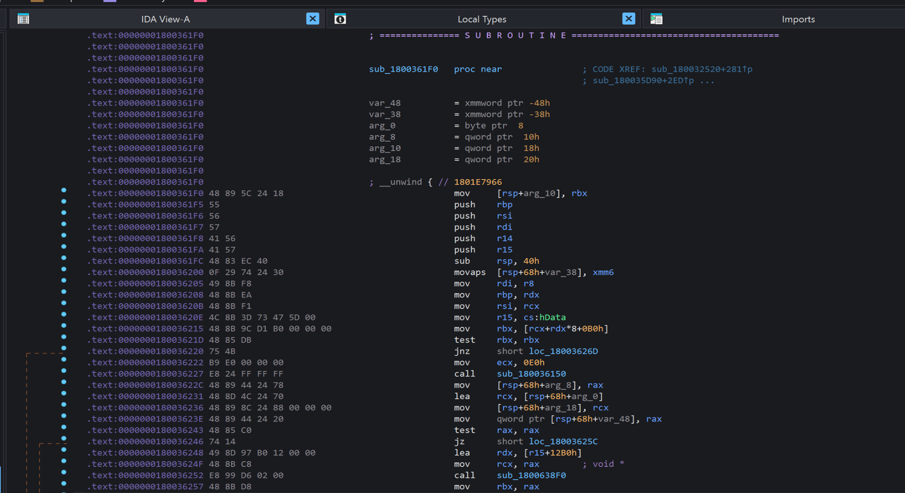
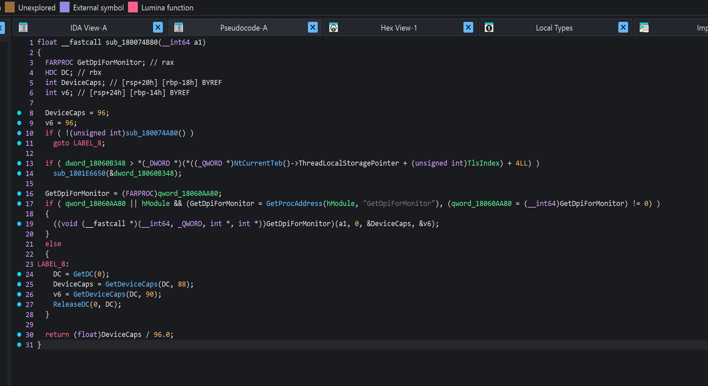
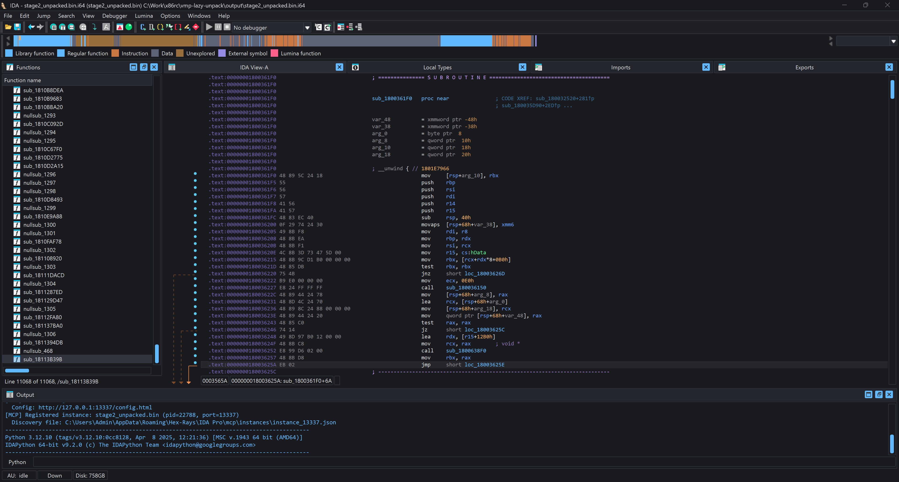

# spectrum-ida-theme

A theme for IDA, comes with a fixed ui and psuedo colouring.

## Preview

<p>
  
  
</p>



## Installation

1. Copy `plugins` and `themes` into your IDA install
2. The default pseudocode formatting is cramped. I recommend these settings for readability. Edit `<IDA install>/cfg/hexrays.cfg`:

```text
RIGHT_MARGIN = 220
GENERATE_EMPTY_LINES = YES
```

## Editing

The plugin can be reused for other themes. Rename the theme folder and edit the palette

Keep the `ThemeOptions`, `ThemeNativeTitleBar`, and other `Theme...` selectors/properties. Use one copy of `theme-helper.py` for all themes.
